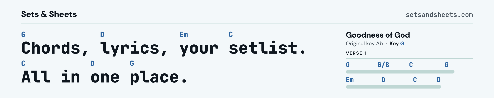
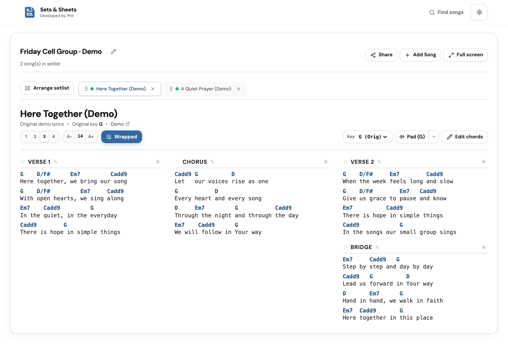
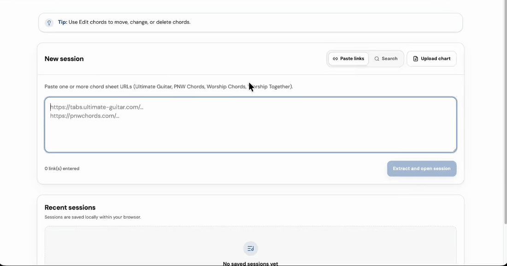
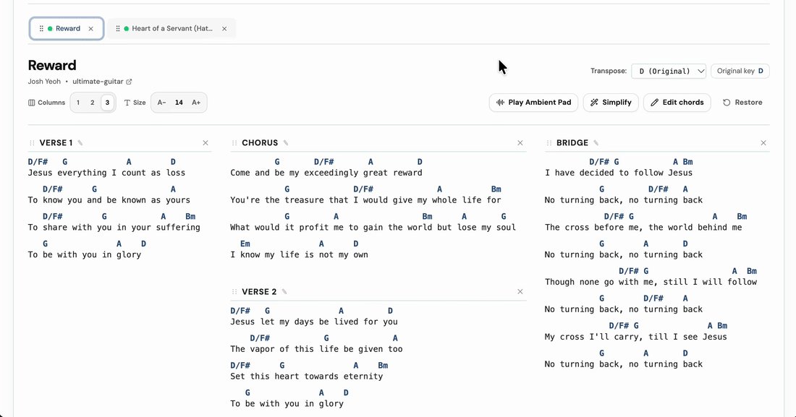
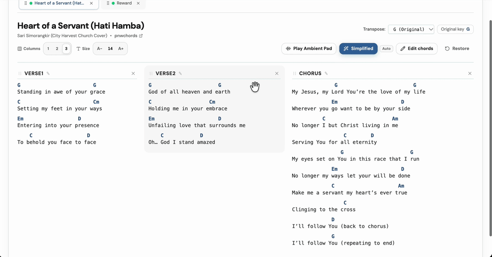
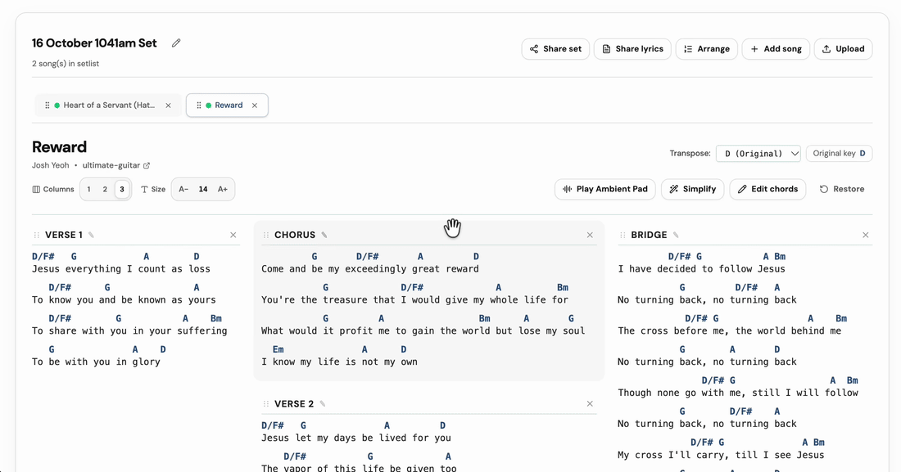
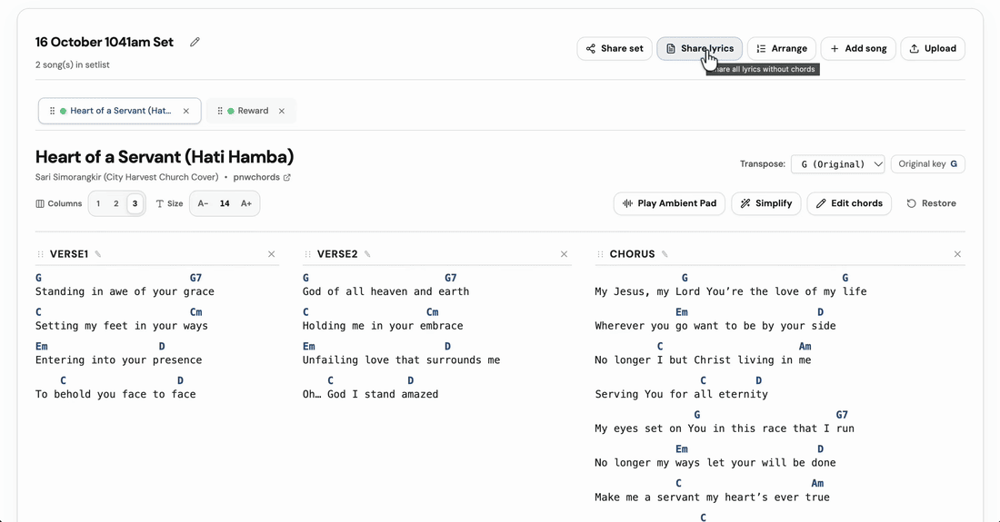
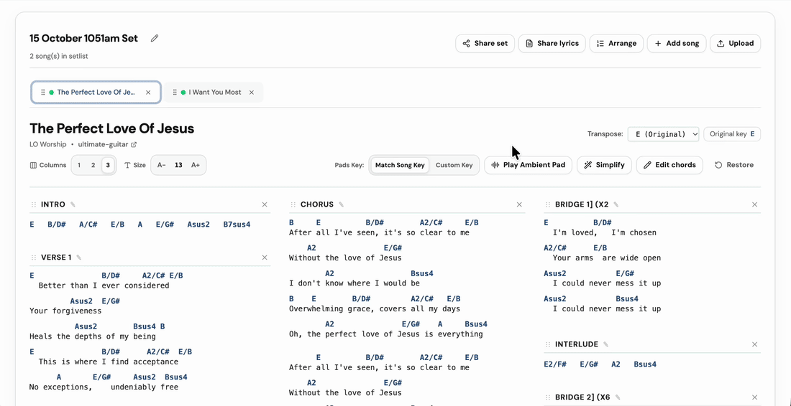
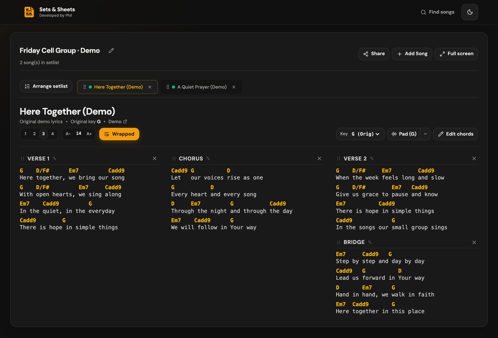

<picture>
  <source media="(prefers-color-scheme: dark)" srcset="docs/marketing/github-banner-dark.png">
  
</picture>

**Chords, lyrics and your setlist, in one place.** Sets & Sheets is a browser-based chord sheet and setlist app for worship teams, cell groups and anyone leading from a guitar. Paste a song, change the key, arrange it the way you play it, and share what your group needs to follow along.

**[Open Sets & Sheets →](https://setsandsheets.com)** — no account needed.



*A two-song demo set in three columns. The screenshots use original demo lyrics.*

## From link to setlist

1. **Add your songs.** Paste a link from a supported chord site, search for a song, or upload a PDF or image chart.
2. **Make the chart fit.** Transpose it, simplify the chords, or edit them by hand.
3. **Build the set.** Name it, add the other songs, and drag them into the order you'll play.
4. **Share it.** Send musicians a copy, share the set live, or send everyone a lyrics-only link.



Your sets and edits save in the browser you're using, so you can come back to them later.

## Prepare the chart

Choose a new key from the **Key** menu and every chord changes with it. **Simplify** uses a simpler chart from the source when one is available, or an automatic version marked **Auto**. Check the result against the arrangement you're playing, as some voicings may change.

Turn on **Edit chords** to tap any chord and change, move or delete it. To match your team's arrangement, drag sections into a new order, rename them, or remove the ones you won't play.





## Build the set your team plays

Drag songs to reorder the set on a computer, or tap **Arrange setlist** at the start of the song tabs on a phone or tablet.

There are two ways to share a set.

**Send a copy** gives your musicians the page address. They open it and get a one-time copy of the songs, names, keys, pad and simplified-chord choices. It doesn't include chord or section edits, or uploaded sheets. It won't change when you do.

**Share live** sends everything: your chord and section edits, uploaded sheets and per-song settings. Musicians who open the link get the set with **Follow Host Edits** on, so your changes reach them as you make them. If a musician edits anything in the set, it asks "Make this your own copy?" and then stops following. They can turn **Follow Host Edits** back on later, which replaces their own changes. Choose **Stop sharing** to end a live share.

Older one-off set links (`/s/`) still open until they expire. The app no longer creates them.



## Give everyone a screen

For cell group worship, open **Share → Share lyrics**, check **See Preview**, then choose **Generate link** and **Copy link**. Everyone gets a simple lyrics-only view with song tabs and no chords. Each person chooses the song on their own phone; it doesn't automatically follow the song you're on.

One link stays with the set. After you change lyrics or section order, choose **Update lyrics** to publish to the same link. Each update renews it for another seven days.

Set links and lyrics links both last seven days and support up to 15 songs. Anyone with the link can open it without an account.



## Fill out the sound

An ambient pad is a sustained background sound that fills out the music when you're playing with just a guitar. Press **Pad** beside the chord controls to start and stop it.

**Match Song** follows the song's selected major key, including when you transpose or switch songs. Using a capo? Open the pad key menu, choose **Custom**, and select the key your guitar actually sounds in. For example, with G shapes and a capo on fret 2, choose **A** for the pad while the chord sheet stays in G.



*The GIF shows the controls; it has no audio. Pads are available for the 12 major keys.*

## Make it comfortable to read

Choose one to four columns and set the text size for your screen. Long chord and lyric lines wrap automatically; turn **Wrapped** off if you'd rather scroll or split them yourself. Use light mode in a bright room and dark mode when you want less glare.



Longer songs may still need scrolling, depending on your screen and text size.

## Before you rely on it

- **Supported chord sites:** Ultimate Guitar, PNW Chords, Worship Chords (`.com` and `.net`) and Worship Together. Other sites aren't supported for link imports, and a supported site may occasionally block one.
- **PDFs and images:** Upload a chart, check the preview and fix anything that looks wrong before adding it. Some files need AI processing and may ask for a Gemini API key if the site doesn't have one configured.
- **Saved in this browser:** Sets aren't synced across devices. Use **Share → Send a copy** to move a set, and don't clear browser data if you need to update an existing lyrics link.
- **Internet access:** Search, new imports, publishing links and fetching shared updates need a connection. Cached songs can be reused, but full offline use isn't supported yet. Open your set and load any pads you need before the session.
- **Live sharing ends** if the host clears browser storage or switches device. Start a new live share.
- **Offline host:** followers keep the last version they got. Changes arrive when the host is back online.
- **Blocked networks:** if a network blocks Firestore, followers get updates every 30 seconds instead of at once.
- **Live shares expire:** they end 7 days after the host's last change or open.
- **Turning on Follow Host Edits** replaces the follower's own changes to that set.
- **Capo changes:** moving the key for a capo counts as an edit. The set becomes the follower's own copy.
- **Song limit:** a live share holds up to 30 songs.
- **What gets stored online:** Copies and live shares include chords and lyrics; lyrics links include lyrics only. Only share content you have permission to share.

Found something that doesn't work, or have an idea? [Open an issue](https://github.com/philkwek/extract-format-lyrics/issues). Include what you were trying to do and, if relevant, the source link or a screenshot.

---

## Technical details

The sections below are for running or working on the project yourself. You don't need any of this to use the website.

<details>
<summary>Stack, local development, deployment and safeguards</summary>

### Stack and storage

- **Frontend:** React 19, TypeScript, Vite, Tailwind CSS and React Router.
- **Local storage:** IndexedDB through `idb-keyval` for songs and sets; browser preferences for display settings.
- **Backend:** Firebase Cloud Functions, Node.js 22, TypeScript and Cheerio. Selectable-text PDFs use direct extraction where possible; other pages and images use Gemini.
- **Hosting:** Firebase Hosting serves the app and routes `/api/**` to the backend. Production chart extraction calls the function directly to allow longer requests.
- **Sharing:** Firestore stores set snapshots in `sharedSets`, live shares in `liveSets` and `liveSetSongs`, and reusable lyrics publications in `sharedLyrics`. Lyrics updates require a secret kept in the publishing browser. Display preferences stay local.

### Run locally

Use Node.js 22 and npm, with the Firebase CLI installed and available as `firebase`.

```bash
git clone https://github.com/philkwek/extract-format-lyrics.git
cd extract-format-lyrics
npm ci
npm --prefix functions ci
npm run dev:all
```

Open [localhost:5173](http://localhost:5173). Vite proxies API requests to the Functions emulator using the `demo-chords` project.

You can also run the two parts in separate terminals:

```bash
npm run dev:backend
```

```bash
npm run dev
```

The default command starts the Functions emulator only. Sharing also needs a Firestore connection; it isn't a complete local sharing setup. For isolated sharing development, configure and run a Firestore emulator and connect the Admin SDK to it.

For images or PDFs that need Gemini, configure `GEMINI_API_KEY` for the backend or provide a key through the upload dialog. Keep credentials out of Git.

### Checks

```bash
npm test
npm run test:functions
npm run lint
npm run build
npm run build:functions
```

Frontend tests live in `srcTest/` and mirror the `src/` folder structure. Backend tests live in `functions/srcTest/` and mirror `functions/src/`. Tests cover parsing, transposition, chord editing, arrangements, local storage, sharing, pad playback logic and backend request guards. Use `npm run preview` to inspect a production frontend build locally.

### Firebase and deployment

For your own deployment:

1. Configure your Firebase project in `.firebaserc` and enable Firestore in Native mode.
2. Configure Firestore TTL policies on the `expiresAt` field for the `sharedSets`, `sharedLyrics`, `setLinks`, `liveSets`, `liveSetSongs` and `songs` collection groups (`songs` holds the content of both lyrics and set links), and on the `ttlAt` field for `searchCache`, `sourceCharts`, `chartAliases` and `chartSimplifications`. The backend checks expiry on read; TTL deletes the data later.
3. Configure the `GEMINI_API_KEY` function secret for chart extraction that needs Gemini.
4. Build and deploy:

```bash
npm run build
npm run build:functions
firebase deploy --only hosting,functions,firestore:rules
```

The Firestore rules deny direct browser access, except that browsers may read (get only, no list or write) single documents in `liveSets` and `liveSetSongs`, so followers get live updates. Deploy the rules (`firestore:rules`) together with the new frontend. The backend uses Admin credentials to write shared content.

[The GitHub Actions workflow](.github/workflows/deploy.yml) runs lint, frontend tests and both builds on pushes to `main`, then deploys Hosting, Functions and Firestore rules. It uses `FIREBASE_SERVICE_ACCOUNT_EXTRACT_FORMAT_LYRICS`, falling back to `FIREBASE_SERVICE_ACCOUNT`. The workflow's deployment project is currently `extract-format-lyrics`; change it for a fork. The service account needs permissions for each deployed service, including Firestore rules.

### Backend safeguards

Link imports use a domain allow-list, DNS/IP checks against private addresses, fetch limits, rate limiting and host circuit breakers. Function instances are capped and can scale down to zero. These controls help limit usage; hosting and AI costs still depend on your traffic and provider settings.

Search/import caching, deadlines, concurrency limits and benchmark reproduction are documented in [the performance guide](docs/performance.md).

### Usage analytics

Google Analytics tracks visits and key actions when enabled for production. Visitors can turn it off under **Privacy and usage tracking**. See the [setup and verification guide](docs/analytics.md) for the existing Firebase stream, Actions variables, event definitions, and reporting steps.

</details>
