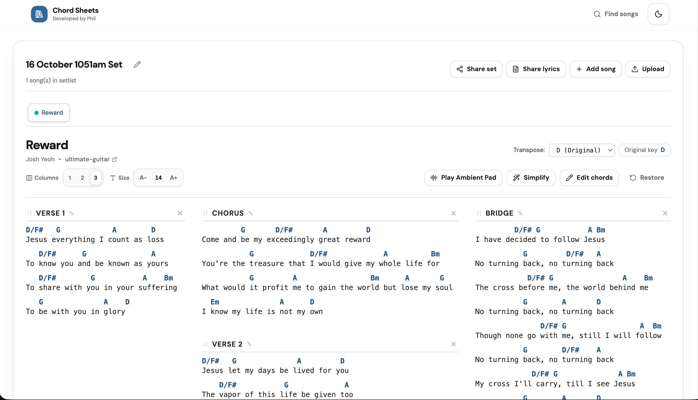
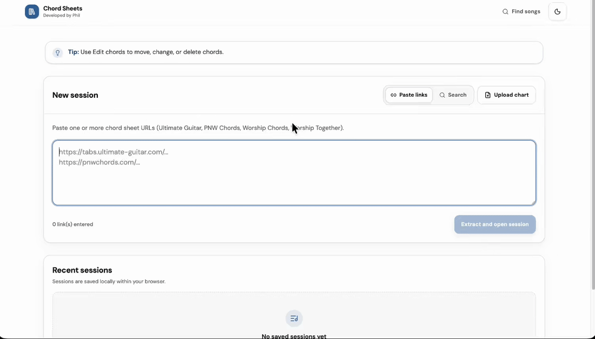
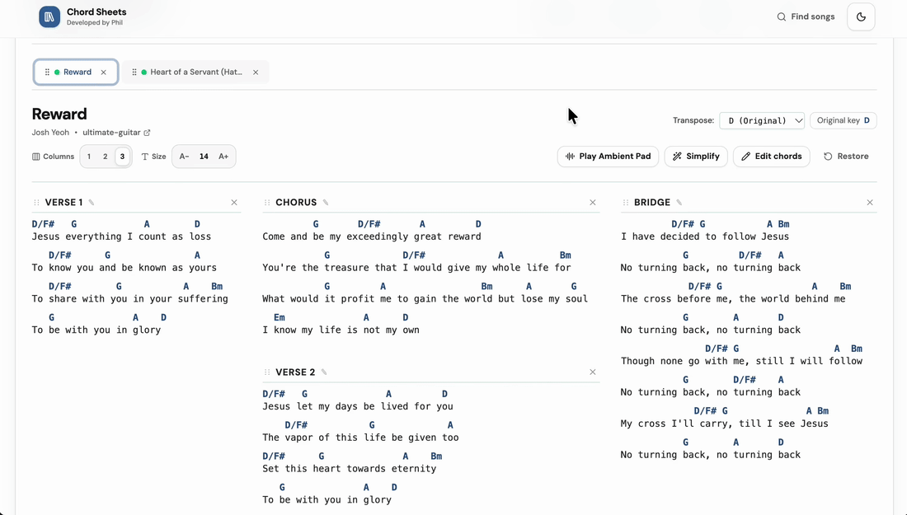
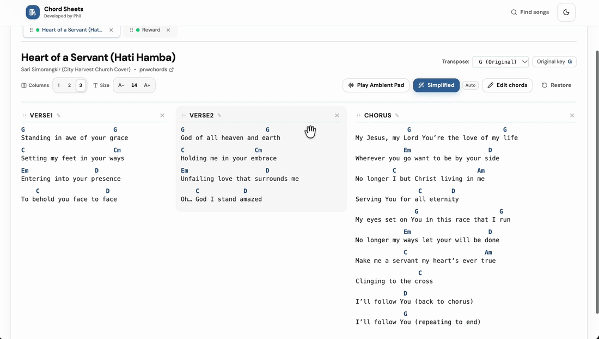
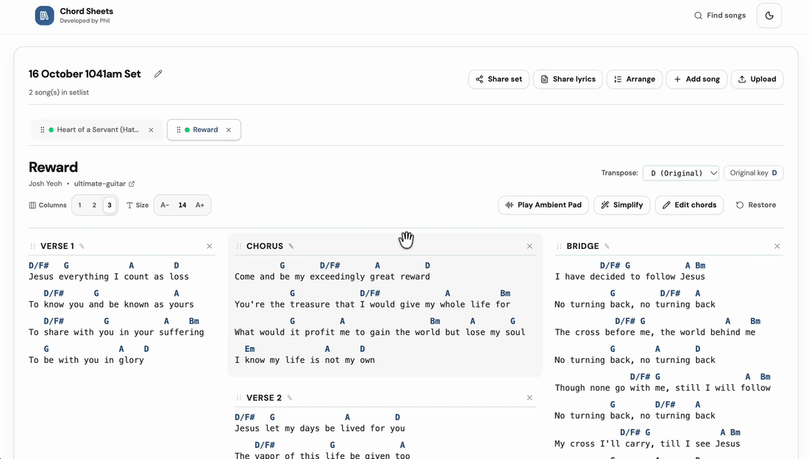
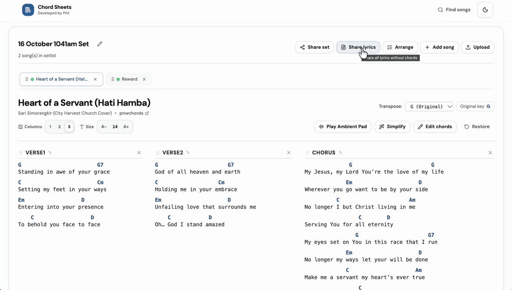
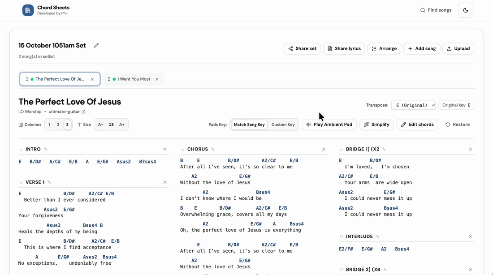
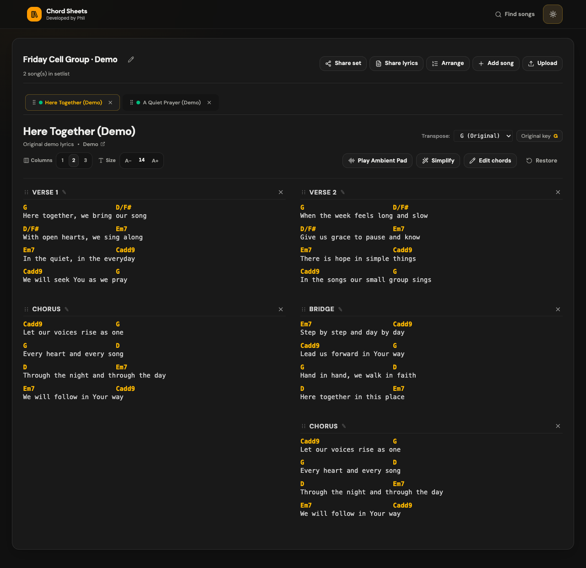

# Chord Sheets

Chords, lyrics and your setlist, all in one place.

Chord Sheets is a website for musicians, worship team volunteers and anyone playing guitar for their cell group. Add your songs, change the key, arrange the sections and share what everyone needs to follow along.

If you're leading with just a guitar, you can also play an ambient pad and send the group a lyrics link from the same website. Less switching between apps while you're trying to lead.

**[Open Chord Sheets](https://extract-format-lyrics.web.app)** · No account needed.



*The images and GIFs show the website in use. The dark mode screenshot uses demo songs.*

## Get started

1. **Add your songs.** Paste chord sheet links on the home page, or use **Search** to find a song. You can also use **Upload chart** for a PDF or image you already have.
2. **Put your set together.** Give it a name, add the other songs and arrange them in the order you want.
3. **Make it work for you.** Change the key, adjust the text size and columns, or edit the chords and sections.
4. **Share it when you're ready.** Open **Share**, then choose **Share this set** for the musicians or **Share lyrics** for everyone singing along.



Your sets and edits save in the browser you're using, so you can come back to them later.

## Change the key and simplify chords

Need a lower key for the singer? Choose a key from **Transpose** and the chords change with it.

For easier chords, try **Simplify**. It uses a simpler chart from the source when available, or an automatic version marked **Auto**. Have a listen and check that it works for your arrangement, as some chords may sound different.



## Edit the chords

Need to change a chord for your arrangement? Turn on **Edit chords**, then tap a chord to change it, move it or delete it.



## Arrange the song the way you play it

Skipping an intro, or using a different section order? Change the song to match your team's arrangement.

- Drag sections to change their order on a computer.
- Use a section's edit button to rename it, or remove sections you don't need.
- Drag the song tabs to reorder your set. On a phone or tablet, open **Edit Set** and use **Arrange setlist**.



## Share lyrics with the group

For cell group worship, people can open the lyrics on their own phones while you play. They get a simple lyrics view with song tabs and no chords.

Open **Share**, choose **Share lyrics**, use **See Preview** to check it, then **Generate link** and **Copy link** to send it to your group.



Each set keeps one reusable lyrics link. If you change the lyrics or section order, click **Update lyrics** to publish the changes to that same link. Each update renews it for another seven days.

Everyone chooses which song to view on their own device. It doesn't automatically follow the song you're on.

## Add an ambient pad while you play

An ambient pad is a sustained background sound that can fill out the music when you're playing with just a guitar. Press **Play Ambient Pad** beside the chord controls to start it. Press it again to stop.

**Match Song Key** makes the pad follow the song's selected major key, including when you transpose or switch songs.

Using a capo? Choose **Custom Key** under **Pads Key** and select the key your guitar actually sounds in. For example, if you're playing G shapes with a capo on fret 2, choose **A** for the pad. Your chord sheet can stay in G while the pad plays in A.



*The GIF shows the controls; it has no audio. Pads are available for the 12 major keys.*

## Send the set to your musicians

**Share this set** gives your team a copy of the songs, including your chord edits, section order, selected keys and simplified chord choices. They can import it and adjust it for themselves.

Set links last seven days and contain the set as it was when you shared it. If you make more changes, create a new set link. Each musician keeps their own text size, columns, line wrapping and theme.

Both set and lyrics links support up to **15 songs**. Anyone with the link can open it without an account.

## Read it comfortably

Choose one, two or three columns and adjust the text size for your screen. Long chord and lyric lines wrap automatically onto the next row; turn off **Wrap** if you prefer to scroll or split them yourself. Use light mode in a bright room or dark mode when you want less glare.



Longer songs may still need scrolling, depending on your screen and text size.

## A few things to know

- **Supported chord sites:** Ultimate Guitar, PNW Chords, Worship Chords (`.com` and `.net`) and Worship Together. Other websites aren't currently supported for link imports. A supported site may sometimes block an import.
- **PDFs and images:** Upload a chart, check the preview and fix anything that looks wrong before adding it to your set. Some files need AI processing and may ask for a Gemini API key if the website doesn't have one configured.
- **Saved on this browser:** Sets aren't synced across devices. Use **Share → Share this set** to move a copy to another device. Clearing browser data can remove your saved sets and your ability to update an existing lyrics link.
- **Internet access:** Search, new imports, publishing links and fetching shared updates need a connection. Cached songs can be reused, but full offline use isn't supported yet. Open your set and load any pads you need before the session.
- **Sharing stores a copy online:** Set links include chords and lyrics; lyrics links include lyrics only. Keep the content you share within the permissions you have from its owners.

Found something that doesn't work, or have an idea? [Open an issue](https://github.com/philkwek/extract-format-lyrics/issues). Include what you were trying to do and, if relevant, the source link or a screenshot.

---

## Technical details

The sections below are for running or working on the project yourself. You don't need any of this to use the website.

### Stack and storage

- **Frontend:** React 19, TypeScript, Vite, Tailwind CSS and React Router.
- **Local storage:** IndexedDB through `idb-keyval` for songs and sets; browser preferences for display settings.
- **Backend:** Firebase Cloud Functions, Node.js 22, TypeScript and Cheerio. Selectable-text PDFs use direct extraction where possible; other pages and images use Gemini.
- **Hosting:** Firebase Hosting serves the app and routes `/api/**` to the backend. Production chart extraction calls the function directly to allow longer requests.
- **Sharing:** Firestore stores set snapshots in `sharedSets` and reusable lyrics publications in `sharedLyrics`. Lyrics updates require a secret kept in the publishing browser. Display preferences stay local.

### Run locally

Use Node.js 22 and npm, with the Firebase CLI installed and available as `firebase`.

```bash
git clone https://github.com/philkwek/extract-format-lyrics.git
cd extract-format-lyrics
npm ci
npm --prefix functions ci
npm run dev:all
```

Open [localhost:5173](http://localhost:5173). Vite proxies API requests to the Functions emulator using the `demo-chords` project.

You can also run the two parts in separate terminals:

```bash
npm run dev:backend
```

```bash
npm run dev
```

The default command starts the Functions emulator only. Sharing also needs a Firestore connection; it isn't a complete local sharing setup. For isolated sharing development, configure and run a Firestore emulator and connect the Admin SDK to it.

For images or PDFs that need Gemini, configure `GEMINI_API_KEY` for the backend or provide a key through the upload dialog. Keep credentials out of Git.

### Checks

```bash
npm test
npm run test:functions
npm run lint
npm run build
npm run build:functions
```

Frontend tests live in `srcTest/` and mirror the `src/` folder structure. Backend tests live in `functions/srcTest/` and mirror `functions/src/`. Tests cover parsing, transposition, chord editing, arrangements, local storage, sharing, pad playback logic and backend request guards. Use `npm run preview` to inspect a production frontend build locally.

### Firebase and deployment

For your own deployment:

1. Configure your Firebase project in `.firebaserc` and enable Firestore in Native mode.
2. Configure Firestore TTL policies on the `expiresAt` field for both the `sharedSets` and `sharedLyrics` collection groups. The backend checks expiry; TTL handles later cleanup.
3. Configure the `GEMINI_API_KEY` function secret for chart extraction that needs Gemini.
4. Build and deploy:

```bash
npm run build
npm run build:functions
firebase deploy --only hosting,functions,firestore:rules
```

The Firestore rules deny direct browser access. The backend uses Admin credentials to read and write shared content.

[The GitHub Actions workflow](.github/workflows/deploy.yml) runs lint, frontend tests and both builds on pushes to `main`, then deploys Hosting, Functions and Firestore rules. It uses `FIREBASE_SERVICE_ACCOUNT_EXTRACT_FORMAT_LYRICS`, falling back to `FIREBASE_SERVICE_ACCOUNT`. The workflow's deployment project is currently `extract-format-lyrics`; change it for a fork. The service account needs permissions for each deployed service, including Firestore rules.

### Backend safeguards

Link imports use a domain allow-list, DNS/IP checks against private addresses, fetch limits, rate limiting and host circuit breakers. Function instances are capped and can scale down to zero. These controls help limit usage; hosting and AI costs still depend on your traffic and provider settings.

Search/import caching, deadlines, concurrency limits and benchmark reproduction are documented in [the performance guide](docs/performance.md).

### Usage analytics

Google Analytics tracks visits and key actions when enabled for production. Visitors can turn it off under **Privacy and usage tracking**. See the [setup and verification guide](docs/analytics.md) for the existing Firebase stream, Actions variables, event definitions, and reporting steps.
